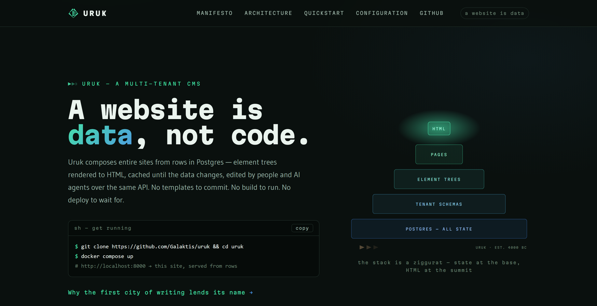

# Uruk

[](https://github.com/Galaktis/uruk/actions/workflows/ci.yml)
[](https://github.com/Galaktis/uruk/actions/workflows/ci.yml)
[](LICENSE)
[](https://www.python.org/)
[](https://www.djangoproject.com/)

**A self-hosted, multi-tenant CMS built for AI agents — and the humans who sign off on their work.**

*Why Uruk? Because history probably started there — yours could too.*

**Website:** [uruk.galaktis.eu](https://uruk.galaktis.eu)

In Uruk a website is **data, not code**: every page is a tree of elements stored in
Postgres, rendered by a small library of generic renderers, cached, and served. There are no
per-site templates, no repository per client, no build, no deploy. One deployment serves
hundreds of sites, each isolated in its own Postgres schema.

The first client is not a web form but an **AI agent over MCP**: it creates pages, writes
content, uploads assets. A human then reviews the draft in the **Studio**, fixes what needs
fixing, and **publishes** — visitors never see a half-built site, and every published
version is kept.

There is no plugin marketplace and no drag-and-drop builder. See
[ARCHITECTURE.md](ARCHITECTURE.md) for the design and its trade-offs.



## What's in the box

- **Multi-tenant by schema** (`django-tenants`): the `Host` header picks the site.
- **Composable elements**: `container`, `text`, `heading`, `image`, `link`, `list`,
  `nav`, `reference` (shared header/footer), `page_list` (collections), `raw_html`.
- **Exact cache invalidation**: a dependency graph evicts only the pages an edit touched.
- **Drafts and revisions**: whole-site snapshots, `/_preview/`, rollback, discard.
- **Collections**: blogs and news with RSS feeds, plus `sitemap.xml` and `robots.txt`.
- **MCP** over streamable HTTP (remote agents) or stdio, and a REST API (django-ninja).
- **Studio**: an htmx review UI at `/_studio/`.
- **Portability**: archive a site with its history and restore it on any Uruk.
- **Production-ready serving**: Granian, Postgres-or-Redis cache, assets in DB or S3,
  OpenTelemetry.

## Try it

```bash
git clone https://github.com/Galaktis/uruk && cd uruk
docker compose up -d          # site on :8000, remote MCP on :8001/mcp (+ Postgres, Redis)
```

Compose pulls the published image, [`galaktis/uruk`](https://hub.docker.com/r/galaktis/uruk)
(also `ghcr.io/galaktis/uruk`, for amd64 and arm64). Pin a release with
`URUK_VERSION=0.1.0`, or run your checkout's code with `docker compose up -d --build`.
You don't even need the clone: `docker-compose.yml` on its own is enough.

The first start migrates the database and seeds a complete default website. Claim its
admin with `POST /api/bootstrap` (the claim code is in `docker compose logs app`), sign in
at `/uruk/`, then build and edit sites over the API or the MCP server.

### The demo: an agent builds a blog

```bash
docker compose exec app uv run python manage.py demo --mcp-url http://mcp:8001/mcp   # = just demo
```

A scripted agent connects to the remote MCP endpoint with an API token, like a hosted agent
would, and builds a small blog on `demo.localhost`: a shared header and footer, a home page,
three posts in a collection with an RSS feed. It publishes, then makes one more edit that it
leaves as a draft. Open http://demo.localhost:8000/ to see the live site, then sign in to
http://demo.localhost:8000/_studio/ with the printed credentials: the draft edit waits for
your review. Publish it, roll it back, or discard it. (`--reset` rebuilds the demo.)

To let a real agent loose instead, issue a token and add the endpoint to your MCP client:

```bash
docker compose exec app uv run python manage.py create_api_token default <username>
```

```json
{ "mcpServers": { "uruk": { "type": "http", "url": "http://localhost:8001/mcp",
  "headers": { "Authorization": "Bearer uruk_…" } } } }
```

### Drafts and publishing

Once a site has been published, edits go to a **working copy**: visitors keep seeing the
live revision until the next publish, and signed-in editors preview the draft at
`/_preview/<path>`. Every publish is kept as a revision — roll back to any of them, or
discard the draft. Over the API: `GET /api/publishing`, `POST /api/publishing/publish`,
`GET /api/revisions`, `POST /api/revisions/{id}/rollback`, `POST /api/publishing/discard`;
over MCP: `publish`, `get_publishing_status`, `list_revisions`, `rollback`, `discard_draft`.
A site that was never published is served live. Details in ARCHITECTURE.md §16.

### Studio — review before you publish

Sign in at `/uruk/` (the admin; `URUK_ADMIN_PATH` moves it), then open **`/_studio/`**: the page tree, each page's element tree,
an editor for content and parameters, and a live draft preview side by side. Fix what the
agent wrote, reorder or delete elements, then publish — or discard the draft, or roll back
to any earlier revision from the history. Every action respects the user's Django
permissions; a read-only user can review but not change anything.

### Blogs and other collections

A collection is a page's child pages — for a blog, give each post `parameters` such as
`{"date": "2026-10-18", "summary": "…", "tags": ["news"]}`. A `page_list` element
(`{"parent_id": "<blog page id>", "tag": …, "limit": …}`) lists them newest first and
refreshes whenever a post changes. Every collection also has an RSS feed at
`<path>/feed.xml`; each site serves `/sitemap.xml` (skip a page with `"noindex": true`) and
`/robots.txt` (override it with the `site.robots_txt` setting).

## Development

Requirements: Python 3.15, [uv](https://docs.astral.sh/uv/), and Docker.

Set up a dev environment:

```bash
docker compose up -d postgres redis   # start the backing services only (= just up)
uv sync                       # install/refresh dependencies
uv run pytest                 # run the test suite (needs Postgres up)
```

Quality gate (run before committing):

```bash
uv run ruff check .           # lint
uv run ruff format .          # format
uv run ty check               # type-check
```

Common Django tasks:

```bash
uv run python manage.py migrate
uv run python manage.py makemigrations
uv run python manage.py runserver
```

Stop the local services with `docker compose down`.

If you use [just](https://just.systems), the `justfile` wraps all of this: `just init-dev`
(services, dependencies, seeded site, admin user), `just test`, `just lint`, `just run`.
Run `just --list` for the rest.

## Production & first-run bootstrap

Uruk is designed to come up autonomously given only database credentials. The single
start command is `docker-entrypoint.sh`, which runs `manage.py bootstrap` once and then
Granian:

```bash
uv run python manage.py bootstrap   # migrate all schemas + ensure the default tenant
uv run granian --interface wsgi config.wsgi:application
```

`bootstrap` is idempotent (safe on every boot). It applies migrations to the public
schema and every tenant schema, then creates the **default tenant** — the catch-all that
answers every host with no more-specific domain. Run it as a *single* pre-start step, not
per Granian worker, so workers don't race on the migration.

### Deploy on one machine (Cloudflare Tunnel)

`docker-compose.prod.yml` turns the compose stack into a small production deployment —
a home server or a VM, no open port, HTTPS at Cloudflare's edge:

```bash
cp .env.prod.example .env      # secret key, DB password, hosts, admin email, tunnel token
docker compose -f docker-compose.yml -f docker-compose.prod.yml up -d --build
```

It binds the website and MCP to `127.0.0.1`, keeps Postgres off the network, drops Redis,
restarts on reboot, starts a blank site (`URUK_DEFAULT_SITE=blank`), and dumps the database
nightly to `./backups` (copy that off the machine). In the Cloudflare dashboard, create a
tunnel, put its token in `.env`, and route your public hostname to `http://app:8000`. Reach
the MCP endpoint over SSH: `ssh -L 8001:127.0.0.1:8001 <server>`.

### Server tuning

`docker-entrypoint.sh` starts Granian with production defaults; override any of them by
setting the matching `URUK_*` variable (they are forwarded to Granian as `GRANIAN_*`
environment options — any other Granian option can be set directly as `GRANIAN_*`):

| Variable                      | Default | Granian option             | Meaning                                                        |
| ----------------------------- | ------- | -------------------------- | -------------------------------------------------------------- |
| `URUK_WORKERS`                | `2`     | `--workers`                | Worker processes.                                               |
| `URUK_BLOCKING_THREADS`       | `8`     | `--blocking-threads`       | WSGI threads per worker — keep ≈ the psycopg pool `max_size`.  |
| `URUK_BACKPRESSURE`           | `16`    | `--backpressure`           | Max in-flight requests per worker.                              |
| `URUK_RESPAWN_FAILED_WORKERS` | `true`  | `--respawn-failed-workers` | Respawn workers that crash.                                     |
| `URUK_WORKERS_LIFETIME`       | `3600`  | `--workers-lifetime`       | Recycle each worker after this many seconds (min 60).           |
| `URUK_WORKERS_MAX_RSS`        | `512`   | `--workers-max-rss`        | Recycle a worker whose memory exceeds this many MiB.            |

Every worker holds its own psycopg connection pool, so keep `workers × pool max_size`
under Postgres `max_connections`. Worker recycling and respawn with more than one
worker require Linux kernel ≥ 5.14.

### Claim the first superuser

No credentials live in the startup path. Instead, claim the default tenant's first
superuser over a one-shot, unauthenticated endpoint that returns a set-password link
(no SMTP needed). Because that link goes to whoever asks, the claim also needs the
tenant's **claim code**, derived from `URUK_SECRET_KEY` so that only the operator can read
it: `manage.py bootstrap` prints it on every boot while the tenant is unclaimed (look in
`docker compose logs app`), and `manage.py claim_code [<schema>]` prints it on demand.
`URUK_ADMIN_EMAIL` further restricts the claim to one address. Once a superuser exists,
the endpoint refuses permanently:

```bash
docker compose exec app uv run python manage.py claim_code   # the default tenant's code

# 1. Claim — returns {"set_password_url": "/api/set-password?uid=...&token=..."}.
#    403 if a superuser already exists, the code is wrong, or URUK_ADMIN_EMAIL doesn't match.
curl -sX POST http://localhost:8000/api/bootstrap \
  -H 'content-type: application/json' -d '{"email":"you@example.com","code":"<claim code>"}'

# 2. Redeem the link to set the password.
curl -sX POST http://localhost:8000/api/set-password \
  -H 'content-type: application/json' \
  -d '{"uid":"<uid>","token":"<token>","password":"<a-strong-password>"}'
```

That superuser is the **platform admin**: only it may create further tenants
(`POST /api/tenants`, or the Django admin). The `POST /api/tenants` response includes the
new tenant's `claim_code`, so its owner can claim it on its own domain.

### API authentication

Two surfaces share the `Authorization: Bearer` header:

- **Humans / browsers → JWT.** `POST /api/auth/login` with `{username, password}` returns
  an `{access, refresh}` pair; `POST /api/auth/refresh` rotates it. Tokens are scoped to
  the tenant they were issued in.
- **MCP / machines → API token.** The long-lived `uruk_…` token (see below) is the right
  primitive for a headless agent — no refresh dance. Issue it with `create_api_token`.

JWTs are signed HS256 with `URUK_SECRET_KEY`. **In production, set `URUK_SECRET_KEY` to at
least 32 bytes** — the insecure dev default is too short and PyJWT will warn.

### Configuration

All configuration is environment-driven: `URUK_*` variables read by `config/settings.py`
(`docker-compose.yml` mirrors the same list as reference comments, and the default website's
`/configuration` page documents them too). The server-tuning variables (`URUK_WORKERS` & co.)
are documented under [Server tuning](#server-tuning) above.

#### Core

| Variable | Default | Purpose |
| --- | --- | --- |
| `URUK_DEBUG` | `False` | Django debug mode. Keep it off anywhere real. |
| `URUK_ENV` | `unknown` | Free-form environment label (production, staging, a laptop). |
| `URUK_SECRET_KEY` | *(insecure dev key)* | Signs sessions and JWTs — set ≥ 32 bytes in production. |
| `URUK_ALLOWED_HOSTS` | `*` | Comma-separated Host allowlist. Uruk routes by hostname, so the catch-all default is deliberate. |
| `URUK_BEHIND_PROXY` | `False` | Trust the proxy's `X-Forwarded-Proto` (HTTPS terminated upstream: Cloudflare Tunnel, Caddy, a load balancer) and mark cookies Secure. Needed for admin/Studio logins behind TLS; enable only when the proxy is the sole way in. |
| `URUK_CSRF_TRUSTED_ORIGINS` | *(empty)* | Extra comma-separated `scheme://host` origins allowed to POST forms (when a proxy rewrites `Host`). |

#### Database

| Variable | Default | Purpose |
| --- | --- | --- |
| `URUK_DB_HOST` | `127.0.0.1` | Postgres host — one database holds every tenant, each in its own schema. |
| `URUK_DB_PORT` | `5433` | Postgres port (matches the bundled compose file). |
| `URUK_DB_NAME` | `uruk` | Database name. |
| `URUK_DB_USER` | `uruk` | Database user. |
| `URUK_DB_PASSWORD` | `uruk` | Database password. |
| `URUK_DB_POOL` | `True` | Native psycopg3 connection pooling — no external pooler needed. |

#### Cache & asset storage

| Variable | Default | Purpose |
| --- | --- | --- |
| `URUK_REDIS_URL` | *(unset)* | Point at Redis and the page/fragment cache moves there; unset, it lives in Postgres (the shared `uruk_cache` table). |
| `URUK_STORAGE_BACKEND` | *(unset)* | Where asset bytes live: unset = the database; `filesystem` or `boto` move the bytes out (rows and hashes stay). |
| `URUK_STORAGE_ROOT` | — | Filesystem backend: directory for the bytes. |
| `URUK_STORAGE_BUCKET` | — | Boto backend: S3-compatible bucket. |
| `URUK_STORAGE_PREFIX` | — | Boto backend: key prefix inside the bucket. |
| `URUK_STORAGE_ENDPOINT_URL` | — | Boto backend: custom endpoint (MinIO, R2, …). |
| `URUK_STORAGE_REGION` | — | Boto backend: bucket region. |

#### Bootstrap & auth

| Variable | Default | Purpose |
| --- | --- | --- |
| `URUK_DEFAULT_TENANT_SCHEMA` | `default` | Schema of the catch-all tenant. |
| `URUK_DEFAULT_TENANT_DOMAIN` | `default.localhost` | Placeholder primary domain for it (routing to it is by fallback, not by this string). |
| `URUK_DEFAULT_SITE` | `showcase` | What the default tenant is seeded with: `showcase` (the packaged Uruk website) or `blank` (one empty landing page). |
| `URUK_ADMIN_EMAIL` | *(empty)* | Restrict the first-superuser claim to this address (on top of the claim code); empty = any address. |
| `URUK_ADMIN_PATH` | `uruk` | URL prefix of the Django admin and its login page (`/uruk/`). Off the well-known `/admin/` to keep scanners away; it shadows a page with the same top-level slug. |
| `URUK_JWT_ACCESS_TTL` | `900` | Access-token lifetime (seconds). |
| `URUK_JWT_REFRESH_TTL` | `1209600` | Refresh-token lifetime (seconds). |

#### Observability (standard `OTEL_*` names — the SDK reads them, so they are not renamed to `URUK_*`)

| Variable | Default | Purpose |
| --- | --- | --- |
| `OTEL_EXPORTER_OTLP_ENDPOINT` | *(unset)* | **The gate.** Point at an OTLP/HTTP collector and tracing turns on (Django, psycopg, Redis, log correlation); unset, the OTel SDK is never even imported. Every request span carries the resolved tenant schema as `uruk.tenant`. |
| `OTEL_SERVICE_NAME` | `uruk` | Service name on exported spans. |
| *(any other `OTEL_*`)* | — | Headers, sampling, resource attributes… all standard [OTel SDK environment variables](https://opentelemetry.io/docs/languages/sdk-configuration/) apply as-is. |

#### MCP (read by the MCP server process, not Django)

| Variable | Default | Purpose |
| --- | --- | --- |
| `URUK_MCP_TENANT` | — | Tenant schema the agent works in. |
| `URUK_MCP_TOKEN` | — | The `uruk_…` API token it authenticates with — the agent gets exactly that user's permissions. |

### Run the MCP server

The admin surface is exposed to an AI agent over MCP, with an API token — the agent can
do exactly what that token's user is permitted. Issue a token with the management
command first:

```bash
uv run python manage.py create_api_token <schema_name> <username>   # prints the token once
```

**Remote (streamable HTTP)** — for hosted agents that connect to a URL. The endpoint is
`/mcp` on port 8001 (`docker compose up` runs it as the `mcp` service; locally
`just mcp_http`). Each request authenticates with `Authorization: Bearer <token>`, and the
`Host` selects the site exactly as for the website, so point the agent at
`https://<your-site>/mcp` behind your reverse proxy. It is stateless, so it scales across
workers and replicas.

**Local (stdio)** — for an agent that launches the server itself:

```bash
URUK_MCP_TENANT=<schema_name> URUK_MCP_TOKEN=<token> uv run python -m mcp_server
```

Tools — discovery: `list_pages`, `get_page_tree`, `list_element_kinds`, `list_elements`,
`get_element`, `get_element_tree` (an element's subtree with ids — how the agent reads
existing structure before editing it), `list_assets`, `get_settings`. Content: `create_page`,
`update_page`, `set_page_root_element`, `delete_page`, `create_element`, `update_element`,
`move_element`, `reorder_children`, `delete_element`. Kinds: `describe_element_kind`. Config & assets: `set_setting`,
`upload_asset`. Preview: `render_page` (returns the rendered HTML of the working copy, so
the agent can see the result of its edits). Publishing: `get_publishing_status`, `publish`,
`list_revisions`, `rollback`, `discard_draft`.

## Contributing

Contributions are welcome — see [CONTRIBUTING.md](CONTRIBUTING.md) for the dev setup and
the quality gate, and [CODE_OF_CONDUCT.md](CODE_OF_CONDUCT.md). Please report security
issues privately as described in [SECURITY.md](SECURITY.md).

## Support Uruk

Uruk is free and open source, built by [Galaktis](https://github.com/Galaktis). If it is
useful to you, you can help keep it going:

- [GitHub Sponsors](https://github.com/sponsors/Galaktis)
- [Ko-fi](https://ko-fi.com/galaktis)

Starring the repository, reporting bugs and sharing what you build with it help too.

## License

Uruk is released under the [BSD 2-Clause License](LICENSE). © Galaktis.

The default site bundles the Gudea and Martian Mono fonts, under the
[SIL Open Font License 1.1](scripts/default_site/fonts/OFL.txt).
